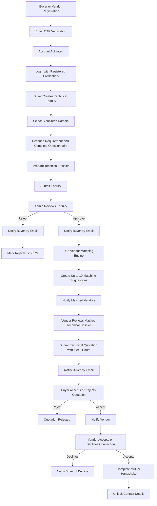
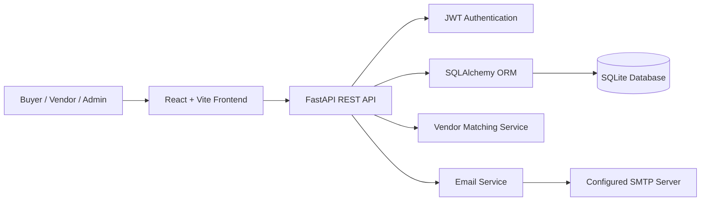

<div align="center">

# 🔄 Enviquo SM Pvt. Ltd.

### Project Workflow & Business Process

**Buyer • Admin • Vendor • Quotations • Mutual Handshake**

</div>

---

## 📌 1. Workflow Overview

Enviquo SM Pvt. Ltd. is an industrial B2B CleanTech marketplace. It organizes technical enquiries, admin review, vendor matching, quotation submission, and buyer-vendor connection through a defined workflow.

### Core rules

- **Registration:** Buyer and Vendor registration does not require admin approval.
- **Email verification:** Buyer and Vendor accounts use email OTP verification.
- **Enquiry approval:** Admin approval applies to technical enquiries, not registration.
- **Vendor matching:** Up to **10 vendor slots** can be created for each approved enquiry.
- **Quotation period:** The vendor quotation window is **240 hours**.
- **Privacy:** Buyer and vendor identities and contact details stay masked until both parties accept the connection and complete the mutual handshake.

---

## 🧭 2. End-to-End Workflow



> [!IMPORTANT]
> The flowchart describes the intended workflow. Actual behavior depends on the implemented backend logic and configuration.

---

## 👤 3. Registration & Login Workflow

### Buyer / Vendor

1. Open the registration page.
2. Complete the relevant registration form.
3. Receive an OTP at the registered email address.
4. Verify the email using the OTP.
5. Activate the account according to the application's authentication rules.
6. Log in using registered credentials.
7. Use the relevant panel and authenticated API endpoints.

### Authentication notes

- JWT tokens are used for authenticated API requests.
- Admin approval is **not** required to register.
- Email delivery depends on the configured SMTP service.
- During local development, email events may appear in the backend terminal if console fallback is enabled.

---

## 🛒 4. Buyer Panel Workflow

The Buyer Panel lets buyers submit technical requirements and manage vendor quotations.

1. Register and verify the email.
2. Log in to the Buyer Panel.
3. Create a new technical enquiry.
4. Select the relevant CleanTech domain.
5. Describe the technical problem or requirement.
6. Complete the technical questionnaire.
7. Prepare the Technical Dossier.
8. Submit the enquiry for admin review.
9. Receive an email when the enquiry is approved or rejected.
10. If approved, wait for matching vendors and quotations.
11. Review submitted quotations.
12. Accept or reject a quotation.
13. If accepted, wait for the vendor's connection decision.
14. View contact details only after mutual handshake completion.

### Buyer enquiry status path

```text
Draft → Submitted → Under Admin Review
                     ├── Rejected
                     └── Approved → Vendor Matching → Quotations
```

*Exact status names depend on the application's implementation.*

---

## 🛡️ 5. Admin Panel Workflow

The Admin Panel is responsible for reviewing technical enquiries.

1. Log in using the configured admin account.
2. View newly submitted enquiries.
3. Review the enquiry details, technical dossier, and questionnaire responses.
4. Approve or reject the enquiry.

### If rejected

- Send a rejection notification email to the buyer.
- Keep the enquiry marked as rejected in the CRM.

### If approved

- Send an approval notification email to the buyer.
- Trigger the vendor matching engine.
- Create up to 10 matching vendor suggestions.
- Notify only the matched vendors.

**Important:** Admin approval applies to technical enquiries, not buyer/vendor registration.

---

## 🏭 6. Vendor Panel Workflow

The Vendor Panel allows eligible vendors to review matched enquiries and submit technical quotations.

1. Register and verify the email.
2. Complete the vendor profile and service-domain information.
3. Log in to the Vendor Panel.
4. Receive a notification when matched with an approved enquiry.
5. Open the matching suggestion.
6. Review the masked Technical Dossier.
7. Prepare and submit a technical quotation within the **240-hour** window.
8. Wait for the buyer's decision.
9. If the buyer accepts the quotation, respond to the connection request by accepting or declining.

### Vendor eligibility

Only vendors who are active and email-verified are eligible for matching suggestions, subject to the application's matching logic.

---

## 🎯 7. Vendor Matching Workflow

The matching engine connects approved technical enquiries to relevant vendors.

### Matching factors

- Registered service domains
- Vendor specialization
- Area of work
- Vendor account status
- Email verification status

### Matching sequence

1. Admin approves a technical enquiry.
2. The matching engine checks eligible vendor profiles.
3. Eligible vendors are assessed using the application's matching logic.
4. Up to **10 vendor slots** are created for the enquiry.
5. Matching suggestions are created.
6. Only matched vendors receive matching notifications.

> [!NOTE]
> The exact scoring formula, tie-breaking rules, and geographic matching behavior are not specified in the supplied project description.

---

## 💬 8. Quotation & Mutual Handshake

This stage manages the buyer's quotation decision and the vendor's decision to connect.

1. Vendor submits a technical quotation.
2. Buyer receives an email notification.
3. Buyer accepts or rejects the quotation.
4. If rejected, the quotation is marked as rejected according to the application's rules.
5. If accepted, the vendor receives a notification.
6. Vendor accepts or declines the connection.
7. If the vendor declines, the buyer can be notified.
8. If both parties accept, the mutual handshake is completed.
9. Contact details are unlocked according to the handshake rules.

### Privacy rule

**Buyer and vendor identities and contact details remain masked before mutual acceptance.** Contact information is unlocked only after both parties accept the connection and the mutual handshake is completed.

---

## 📧 9. Email Notification Events

| Event | Recipient | Purpose |
|---|---|---|
| Buyer registration OTP | Buyer | Verify email address |
| Vendor registration OTP | Vendor | Verify email address |
| New enquiry submitted | Admin | Notify admin for review |
| Enquiry approved | Buyer | Confirm approval |
| Enquiry rejected | Buyer | Communicate rejection |
| Approved enquiry matched | Matched vendors | Notify vendors of a matching opportunity |
| Quotation submitted | Buyer | Notify buyer of a new quotation |
| Buyer accepts quotation | Vendor | Notify vendor of buyer's decision |
| Vendor accepts or declines connection | Buyer | Communicate connection decision |
| Mutual handshake completed | Buyer and Vendor | Confirm the connection |

Email delivery requires valid SMTP configuration for real inbox delivery. A local console fallback, if configured, prints email events in the backend terminal instead.

---

## 🧱 10. Technical Architecture



### Main technologies

| Layer | Technology / responsibility |
|---|---|
| Frontend | React, Vite, Axios, React Router |
| Backend | FastAPI |
| Data access | SQLAlchemy |
| Database | SQLite |
| Authentication | JWT |
| Email | SMTP-ready email service with optional local console fallback |
| User areas | Buyer, Vendor/Seller, Admin |

**Scope note:** AI, RAG, and LLM capabilities are not included in this workflow version.

---

## 🔐 11. Security & Privacy Controls

- Verify buyer and vendor email addresses through OTP.
- Protect authenticated API endpoints with JWT.
- Keep secrets and credentials in environment variables.
- Validate enquiry, quotation, and handshake actions on the backend.
- Mask buyer and vendor contact details until mutual handshake completion.
- Change default admin credentials before deployment.
- Use HTTPS and secure production environment settings.
- Restrict CORS to the required frontend origins.
- Never commit SMTP passwords, JWT secrets, or production `.env` files to source control.

---

## ⏱️ 12. Business Rules at a Glance

| Rule | Defined behavior |
|---|---|
| Registration approval | No admin approval required |
| Email verification | OTP for buyers and vendors |
| Admin approval | Required for technical enquiries |
| Matching limit | Maximum 10 vendor slots per approved enquiry |
| Vendor eligibility | Active and email-verified |
| Quotation window | 240 hours |
| Contact privacy | Masked until mutual handshake completion |
| Rejected enquiry | Remains marked as rejected in CRM |
| AI / RAG / LLM | Outside this workflow version's scope |

---

## ✅ 13. End-to-End Testing Checklist

### Registration & authentication
- [ ] Buyer can register and verify email OTP.
- [ ] Vendor can register and verify email OTP.
- [ ] Registration does not require admin approval.
- [ ] Valid users can log in and access the correct panel.
- [ ] Protected API endpoints validate authentication.

### Buyer enquiry
- [ ] Buyer can create and submit a technical enquiry.
- [ ] Enquiry includes the selected domain and questionnaire responses.
- [ ] Admin receives the new-enquiry notification.
- [ ] Buyer receives approval or rejection notification.

### Admin review & matching
- [ ] Admin can review the technical dossier.
- [ ] Rejected enquiries remain rejected in CRM.
- [ ] Approved enquiries trigger vendor matching.
- [ ] Only eligible, matched vendors receive notifications.
- [ ] Matching never exceeds 10 vendor slots per enquiry.

### Quotations & handshake
- [ ] Matched vendors can view the masked dossier.
- [ ] The 240-hour quotation window is enforced.
- [ ] Buyer receives a notification when a quotation is submitted.
- [ ] Buyer can accept or reject a quotation.
- [ ] Vendor can accept or decline the connection.
- [ ] Contact details remain masked before mutual handshake.
- [ ] Contact details unlock only after handshake completion.

### Production readiness
- [ ] Production SMTP delivery is tested.
- [ ] Default admin credentials are changed.
- [ ] JWT secret is secure and unique.
- [ ] CORS and HTTPS are configured.
- [ ] Persistent database storage is configured.
- [ ] Secrets and local database files are excluded from Git.

---

## 📌 14. Important Implementation Notes

- This document describes the workflow specified in the project README.
- Exact database status values, API routes, matching scores, and error-handling details depend on the actual implementation.
- The flowchart is a process overview, not proof that every step has already been implemented.
- Verify each checklist item against the running application before production deployment.

---

<div align="center">

**Enviquo SM Pvt. Ltd.**  
*Industrial B2B CleanTech Marketplace*

</div>
