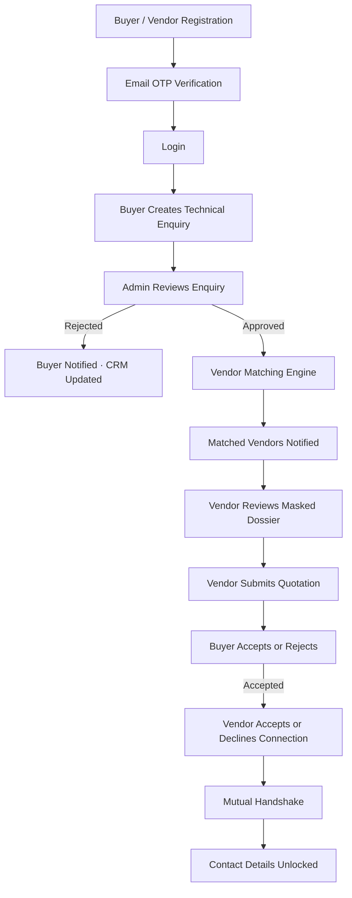

<div align="center">

# 🌱 Enviquo SM Pvt. Ltd.

### Industrial B2B CleanTech Marketplace

**A full-stack platform connecting buyers, qualified vendors, and administrators through a structured technical-enquiry and quotation workflow.**


</div>

---

> [!NOTE]
> An industrial B2B CleanTech marketplace built according to the supplied project blueprint. This workflow version does **not** include AI, RAG, or LLM features.

---

## 📚 Table of Contents

- [✨ Platform at a Glance](#-platform-at-a-glance)
- [🧰 Tech Stack](#-tech-stack)
- [👥 Three Panels](#-three-panels)
- [🔐 Registration and Authentication](#-registration-and-authentication)
- [🔄 Enquiry Workflow](#-enquiry-workflow)
- [📧 Email Notifications](#-email-notifications)
- [🎯 Vendor Matching Engine](#-vendor-matching-engine)
- [🗂️ Project Structure](#️-project-structure)
- [⚙️ Prerequisites](#️-prerequisites)
- [🚀 Run the Backend](#-run-the-backend)
- [💻 Run the Frontend](#-run-the-frontend)
- [🔧 Environment Configuration](#-environment-configuration)
- [👤 Local Admin Account](#-local-admin-account)
- [✉️ Email Configuration](#️-email-configuration)
- [🗄️ Database](#️-database)
- [🛡️ Security and Privacy](#️-security-and-privacy)
- [✅ Deployment Checklist](#-deployment-checklist)
- [📌 Important Notes](#-important-notes)

---

## ✨ Platform at a Glance

The platform organizes technical enquiries, administrator review, vendor matching, quotation submission, and mutual acceptance in one workflow.



### Key workflow rules

- ✅ Registration does **not** require admin approval.
- 🔐 Buyer and vendor email verification uses OTP.
- 🧑‍💼 Admin approval is required for technical enquiries.
- 🎯 A maximum of **10 vendor slots** is allowed per approved enquiry.
- ⏱️ Vendors have a **240-hour quotation window**.
- 🤝 Contact details are unlocked only after the mutual handshake.

---

## 🧰 Tech Stack

---

## Tech Stack

- **Frontend:** React, Vite, Axios, React Router
- **Backend:** FastAPI, SQLAlchemy, SQLite, JWT
- **Email:** SMTP-ready email service with local console fallback
- **Authentication:** Email OTP verification and JWT-based login
- **Workflow:** Buyer, Vendor/Seller, and Admin panels
- **AI / RAG / LLM:** Not included in this workflow version

---

## 👥 Three Panels

1. **Buyer Panel** — Create and track technical enquiries, review quotations, and accept or reject offers.
2. **Vendor / Seller Panel** — Receive matching suggestions, review masked technical dossiers, and submit technical quotations.
3. **Admin Panel** — Review submitted enquiries and approve or reject them.

---

## 🔐 Registration and Authentication

Buyer and Vendor registration is activated through email OTP verification.

**Admin approval is not required for registration.** Admin approval is required only for technical enquiries.

- Buyers and vendors register using the registration form.
- An email OTP is sent for verification.
- After successful verification, the account is activated according to the application's authentication rules.
- Users can log in using their registered credentials.
- JWT tokens are used for authenticated API requests.

---

## 🔄 Enquiry Workflow

### 🛒 1. Buyer Workflow

The buyer follows this process:

1. Register an account.
2. Verify the email using OTP.
3. Log in to the Buyer Panel.
4. Create a technical enquiry.
5. Select the relevant CleanTech domain.
6. Describe the technical problem or requirement.
7. Complete the technical questionnaire.
8. Prepare the Technical Dossier.
9. Submit the enquiry for admin review.

### 🛡️ 2. Admin Workflow

The admin reviews newly submitted technical enquiries.

- View new enquiries.
- Review the technical dossier and questionnaire responses.
- Approve or reject the enquiry.

**If the enquiry is rejected:**

- The buyer is notified by email.
- The enquiry remains marked as rejected in the CRM.

**If the enquiry is approved:**

- The buyer is notified by email.
- The matching engine runs.
- Up to 10 matching vendor suggestions are created.
- Only matched vendors are notified by email.

### 🏭 3. Vendor Workflow

After an approved enquiry is matched with a vendor:

1. The vendor receives an email notification.
2. The vendor views the matching suggestion.
3. The vendor reviews the masked Technical Dossier.
4. A 240-hour quotation window applies.
5. The vendor submits a technical quotation.

Buyer and vendor identities and contact details remain masked before mutual acceptance.

### 🤝 4. Quotation and Handshake Workflow

1. The buyer receives an email notification when a quotation is submitted.
2. The buyer accepts or rejects the quotation.
3. If accepted, the vendor is notified.
4. The vendor accepts or declines the connection.
5. After mutual acceptance, the handshake is completed.
6. Contact details are unlocked according to the application's handshake rules.

> [!IMPORTANT]
> **Privacy rule:** Buyer and vendor identity and contact information remain masked until both parties accept the connection and complete the mutual handshake.

---

## 📧 Email Notifications

The platform supports the following email events:

- Buyer registration OTP
- Vendor registration OTP
- New enquiry notification to Admin
- Enquiry approval notification to Buyer
- Enquiry rejection notification to Buyer
- Approved enquiry matching notification to matched Vendors
- Quotation submission notification to Buyer
- Buyer quotation acceptance notification to Vendor
- Vendor connection acceptance or decline notification to Buyer
- Mutual handshake notification to both parties

Email delivery depends on the configured email service and SMTP settings.

---

## 🎯 Vendor Matching Engine

The matching engine connects approved technical enquiries with relevant vendors.

Matching considers:

- Registered service domains
- Vendor specialization
- Area of work
- Vendor account status
- Email verification status

Only active, email-verified vendors are eligible to receive matching suggestions.

**Matching limit:** A maximum of 10 vendor slots is allowed per approved enquiry.

The matching engine creates suggestions for eligible vendors based on the application's matching logic. Only matched vendors receive matching notifications.

---

## 🗂️ Project Structure

The project contains a React frontend and a FastAPI backend.

```text
SM_CleanTech_Platform/
├── backend/
│   ├── app/
│   │   ├── api/
│   │   ├── core/
│   │   ├── models/
│   │   ├── schemas/
│   │   ├── services/
│   │   ├── db.py
│   │   └── main.py
│   ├── requirements.txt
│   └── .env.example
│
├── frontend/
│   ├── src/
│   ├── public/
│   ├── package.json
│   └── .env.example
│
└── README.md
```

*Note: The directory tree illustrates the intended organization. Actual subdirectories and files may differ in the supplied project.*

---

## ⚙️ Prerequisites

Install the following before running the project:

- Python
- Node.js and npm
- Git (optional, for version control)

---

## 🚀 Run the Backend

Open a terminal in the project root and run:

```bash
cd backend
python -m venv .venv                       # Create Once Time
```

Activate the virtual environment.


**Windows Command Prompt:**

```cmd
.venv\Scripts\activate                      # Activate Every Time When You Project Run
```

Install backend dependencies:

```bash
pip install -r requirements.txt              # Install Once Time
```

Create your local environment file.

**Windows:**

```cmd
.env                                        # Check Once Time
```

Configure the required environment variables in `backend/.env`, then start the server:

```bash
uvicorn app.main:app --reload              # Run Every Time
```

Backend URLs:

- **API Base:** [http://127.0.0.1:8000](http://127.0.0.1:8000)
- **Swagger Documentation:** [http://127.0.0.1:8000/docs](http://127.0.0.1:8000/docs)
- **Health Check:** [http://127.0.0.1:8000/health](http://127.0.0.1:8000/health)

---

## 💻 Run the Frontend

Open another terminal from the project root:

```bash
cd frontend
npm install                                  # Create Once Time
```

Create the frontend environment file:

**Windows:**

```cmd
.env                                         # Check Once Time
```

Configure the backend API URL in `frontend/.env`:

```env
VITE_API_URL=http://127.0.0.1:8000/api
```

Start the development server:

```bash
npm run dev                                   # Run Every Time
```

Frontend URL:

- **React Application:** [http://localhost:5173](http://localhost:5173)

Restart the Vite development server after changing environment variables.

---

## 🔧 Environment Configuration

### 🔒 Backend `.env`

Configure the values required by your backend settings.

```env
APP_NAME=SM Clean Tech Engineering Solutions

DATABASE_URL=sqlite:///./sm_cleantech.db

JWT_SECRET_KEY=replace-with-a-secure-random-secret
JWT_ALGORITHM=HS256
ACCESS_TOKEN_EXPIRE_MINUTES=1440

FRONTEND_URL=http://localhost:5173

ADMIN_EMAIL=admin@smcleantech.com
ADMIN_PASSWORD=replace-with-a-secure-admin-password

SMTP_HOST=
SMTP_PORT=587
SMTP_USERNAME=
SMTP_PASSWORD=
SMTP_FROM_EMAIL=
SMTP_FROM_NAME=SM Clean Tech Engineering Solutions

GROQ_API_KEY=
GEMINI_API_KEY=
EMBEDDING_MODEL=gemini-embedding-2
GROQ_MODEL=openai/gpt-oss-120b

```

The backend configuration uses environment variables and the configured `.env` file.

### 🌐 Frontend `.env`

```env
VITE_API_URL=http://127.0.0.1:8000/api
```

The frontend should use `import.meta.env.VITE_API_URL` instead of hardcoded backend URLs.

For production deployment, configure the actual deployed backend API URL in the frontend hosting environment.

---

## 👤 Local Admin Account

The project blueprint provides these initial admin credentials:

- **Email:** `admin@smcleantech.com`
- **Password:** `Admin@12345`

> [!WARNING]
> Change the default admin password and JWT secret before deployment.

Ensure the initial admin account is created or seeded according to the backend implementation.

---

## ✉️ Email Configuration

### 🧪 Local Development

For local testing, SMTP settings may be left empty if the configured email service supports console fallback.

In that case, email events are printed in the backend terminal rather than delivered to real email inboxes.

### 🚀 Production

Configure valid SMTP credentials and sender details in the backend environment:

- `SMTP_HOST`
- `SMTP_PORT`
- `SMTP_USERNAME`
- `SMTP_PASSWORD`
- `SMTP_FROM_EMAIL`
- `SMTP_FROM_NAME`

Verify email delivery before enabling production registration and password-reset workflows.

> [!CAUTION]
> **Security:** Never commit real SMTP passwords, API credentials, JWT secrets, or production environment files to GitHub.

---

## 🗄️ Database

The platform uses SQLite with SQLAlchemy.

- The database is configured through `DATABASE_URL`.
- The database file is created automatically when the application initializes its database schema, according to the backend implementation.
- The deliverable intentionally excludes personal or test database files.
- Initial seed data, including the admin account, depends on the application's database seeding configuration.

For production environments, use an appropriate persistent database and storage configuration.

---

## 🛡️ Security and Privacy

- Verify buyer and vendor email addresses through OTP.
- Protect authenticated API endpoints using JWT.
- Keep secret values in environment variables.
- Do not expose buyer or vendor contact details before mutual handshake completion.
- Validate enquiry, quotation, and handshake operations on the backend.
- Change default admin credentials before deployment.
- Use HTTPS and secure production environment settings.

---

## ✅ Deployment Checklist

Before deploying the application:

- [ ] Set a secure `JWT_SECRET_KEY`.
- [ ] Change the default admin password.
- [ ] Configure the production `FRONTEND_URL`.
- [ ] Configure the frontend `VITE_API_URL`.
- [ ] Configure SMTP credentials.
- [ ] Confirm the admin account initialization process.
- [ ] Configure persistent database storage.
- [ ] Configure CORS to allow only the required frontend origins.
- [ ] Test email OTP verification.
- [ ] Test enquiry approval and rejection.
- [ ] Test vendor matching and the 10-vendor limit.
- [ ] Test quotation submission and the 240-hour window.
- [ ] Test mutual handshake and contact-detail unlocking.
- [ ] Confirm that secrets and local database files are excluded from Git.

---

## 📌 Important Notes

- Buyer and Vendor registration does not require admin approval.
- Admin approval applies to technical enquiries.
- Rejected enquiries remain rejected in the CRM.
- Only eligible matched vendors are notified about approved enquiries.
- The matching engine supports up to 10 vendor slots per enquiry.
- The quotation window is 240 hours.
- Contact details are unlocked only after mutual handshake completion.
- AI, RAG, and LLM features are outside the scope of this workflow version.

---

**SM Clean Tech Engineering Solutions**

*Industrial B2B CleanTech Marketplace*

---

<div align="center">

**SM Clean Tech Engineering Solutions**  
*Industrial B2B CleanTech Marketplace*

</div>
